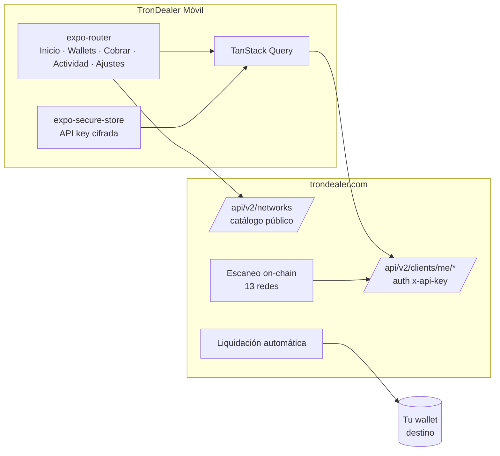

<div align="center">


# TronDealer Móvil

**La app de comerciante de la primera pasarela de pagos cripto non-custodial multi-chain con app móvil nativa.**

Cobra en USDT/USDC en 13 redes, recibe los fondos directo en TU wallet, y gestiona tu negocio desde el bolsillo.

[](https://docs.expo.dev/versions/v57.0.0/)
[](https://reactnative.dev)
[](https://www.typescriptlang.org/)
[](https://trondealer.com)
[](https://qvapay.com)

[trondealer.com](https://trondealer.com) · [Documentación API](https://trondealer.com/es/docs) · [Guías](https://trondealer.com/es/guides)

</div>

---

## Por qué existe

Ninguna pasarela cripto genuinamente non-custodial tiene una app móvil de comerciante. Las que tienen app custodian tus fondos; las que no custodian solo tienen dashboards web. TronDealer Móvil cierra ese hueco: **los pagos llegan directo a wallets cuyas claves gestiona la pasarela por ti pero cuyo destino final controlas tú — nadie puede congelar tus fondos** — y el negocio entero se opera desde el teléfono.

## Qué hace

| | |
|---|---|
| **Cobrar (POS)** | Teclado en USD con conversión y **tasa siempre visible** (nada de spreads ocultos), QR a pantalla completa, detección on-chain automática y confirmación con el ciclo detectado → confirmado en vivo. TRON confirma en segundos. |
| **Multi-chain** | El selector de red se construye solo desde el catálogo público de la API: TRON, TON, Solana, BSC, Base, Polygon, Arbitrum, Ethereum, Optimism, Avalanche y SUI, con USDT/USDC (y PYUSD en Ethereum). |
| **Wallets** | Multiwallet por subsistema con etiquetas, asignación idempotente y una sola dirección EVM que sirve 7 redes. |
| **Actividad** | Feed cruzado de depósitos y liquidaciones con estados semánticos y detalle por transacción: confirmaciones en vivo, hash, origen, estado del webhook y link al explorador de cada red. |
| **Ajustes** | Destino de liquidación, comisiones, toggles de notificación, salud de webhooks y sesión. |

La liquidación (sweep) corre automática en el backend hacia el destino que configure el negocio: wallet propia, QvaPay o Zelle. Comisión: 0.4% (+$0.30 en cobros menores de $10) solo en payouts a wallet.

## Arranque rápido

```bash
git clone https://github.com/qvapay/TronDealer.git
cd TronDealer
npm install
npx expo start        # pulsa i (simulador iOS) o a (Android / dispositivo USB)
```

Entra con la API key `td_…` de tu negocio ([regístrate en 30 segundos](https://trondealer.com/es/onboard) — sin formularios de contacto, sin llamada de ventas). La key se guarda cifrada en el Keychain/Keystore del dispositivo y nunca sale de él salvo hacia la API.

```bash
# Apuntar a otro backend (por defecto: producción)
EXPO_PUBLIC_API_URL=http://192.168.0.10:3000 npx expo start
```

## Arquitectura



- **Auth sin cookies**: todos los endpoints del cliente aceptan el header `x-api-key`; la app valida credenciales contra `GET /api/v2/clients/me`.
- **Detección del cobro**: polling del endpoint de transacciones de cada chain (4 s). Cuando el backend estrene push, el POS pasará a notificación instantánea sin cambiar de arquitectura.
- **Catálogo dinámico**: redes, assets, decimales y confirmaciones mínimas vienen de `/api/v2/networks` — añadir un token en el backend lo hace aparecer en la app sin release.

```
src/
├── app/            # expo-router: login, register, (tabs)/, charge/ (POS), tx/[hash]
├── api/            # cliente fetch + hooks tipados (espejo de las rutas del backend)
├── auth/           # contexto de sesión sobre expo-secure-store
├── components/     # UI base The Dealer + iconos SVG + filas de transacción
├── i18n/           # ES (default) / EN
├── lib/            # exploradores por red, mapeo chain, ids nativos de tx
└── theme/          # tokens del design system
```

## Design system — "The Dealer"

Portado 1:1 del [sitio web](https://trondealer.com): superficies tinta (`#0C0C0B`/`#141413`), texto hueso, **rojo señal `#E5484D` solo como marca — nunca como error**, verde `#46C28E` y ámbar `#E8B33C` reservados a la semántica on-chain (confirmado / detectando). Radios cuadrados 2/6/10 px, sin gradientes. Tipografías: Archivo Expanded (titulares — cortes estáticos instanciados de la fuente variable, porque React Native no soporta `font-stretch`), Instrument Sans (cuerpo) e IBM Plex Mono (montos, hashes, labels).

## Roadmap

- [x] Login por API key + dashboard multi-chain
- [x] Modo POS con selector de red/asset y tasa transparente
- [x] Detalle de transacción con confirmaciones en vivo
- [ ] Notificaciones push de depósitos (requiere backend Fase 0)
- [ ] Face ID y rotación de API key
- [ ] Wallets de un solo uso por cobro
- [ ] EAS Build + TestFlight / Play Console
- [ ] Links de pago y suscripciones
- [ ] Modo admin

## Relacionado

- [trondealer.com](https://trondealer.com) — la pasarela (web + API)
- [v2-openapi.json](https://trondealer.com/v2-openapi.json) — especificación OpenAPI
- [trondealer-woocommerce](https://github.com/qvapay/trondealer-woocommerce) — plugin de WooCommerce
- [QvaPay](https://qvapay.com) — la empresa detrás

## Licencia

El código está bajo la [licencia MIT](LICENSE). El nombre y el logo de TronDealer no están incluidos: consulta [TRADEMARKS.md](TRADEMARKS.md) antes de distribuir un fork. Las fuentes Archivo de `assets/fonts/` están bajo la [SIL Open Font License](assets/fonts/OFL.txt).

---

<div align="center">
<sub>Construido con Expo. Los fondos nunca pasan por nosotros — eso es el punto.</sub>
</div>
